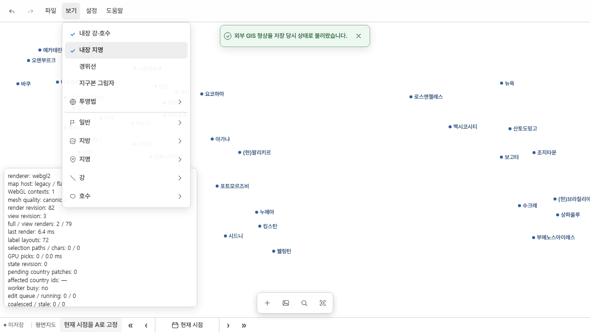
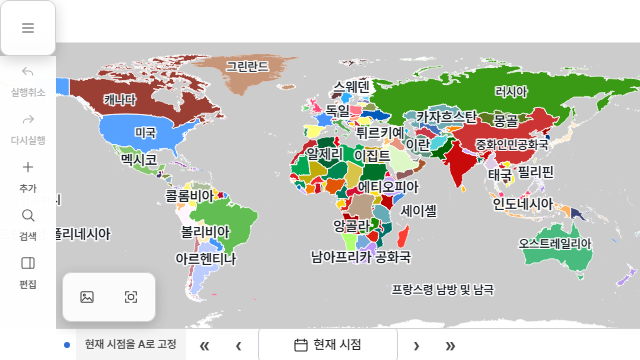

# 앱 편집 집중과 프로젝트 저장 범위 변경 검증

> 보고서 ID: `UI-EDITOR-FOCUS-20261019` · 상태: `focused-verified / android-device-unverified` · 지도 반영: `not-applicable` · 색인일: 2026-10-19  
> 원문 최종 수정: 2026-10-19  
> 조사 기준: 웹·앱 `work/ui` 기준 커밋 `44fb6d41977123b5220cde8078f1e9a7e38b2728` + 기존 WIP와 이번 미커밋 변경  
> 원본·출처: [승인 계획](../../../docs/superpowers/plans/2026-10-19-editor-focus-project-storage.md), [실행 원장](../../../.superpowers/sdd/2026-10-19-editor-focus-project-storage/progress.md)

## 대상과 기준일

Windows·Android 앱을 편집 중심으로 만들고, 공통 Web/Core 프로젝트 포맷을 12로 변경한 로컬 구현이다. 웹은 지형 배경을 유지한다. 기존 work/ui의 프로젝트 설정·비교·편집 WIP를 보존했다. main 통합, 커밋·푸시·공개 배포는 하지 않았다. 원격 work/ui의 generated-only 후속 커밋을 겹치는 WIP 위에 병합하지 않고, 현재 소스에서 산출물을 다시 생성했다.

## 구현과 저장 계약

| 소유 위치 | 현재 범위 |
| --- | --- |
| 프로젝트 v12 | 안정적인 documentId, 작성 객체·형상·기간·속성·스타일·실제 첨부·형상 출처와 아카이브, 명시적으로 작성한 defaultView |
| defaultView | 기본 월, 객체 그룹·개별 표시, 분포 대상·모드·경계 표시. 프로젝트 설정의 명시적 지정 명령으로만 변경하며 Undo/Redo·dirty·자동저장을 지원 |
| documentId별 기기 작업상태 | 현재 월, 카메라, 투영, 임시 객체 표시·분포 설정. 탐색만으로 작성 문서나 dirty 상태가 바뀌지 않음 |
| 기기 환경설정 | 지형 모드, 내장 수계·지명, 경위선, 지구본 그림자. 웹·앱 배경 선호와 기존 테마 선호 유지 |

새 문서는 새 UUID를 사용하고 저장·재열기는 ID를 유지한다. editorState.lastViewedMonth와 physicalSettings는 프로젝트 저장물에서 제거했다. 실제 형상 의존 physicalSourceInfo는 유지한다. 구형 v11 읽기·변환 경로를 추가하지 않았다. 거절된 자동저장이 어느 슬롯에 있든, 읽기 오류 재시도와 유효 v12 슬롯 동시 존재까지 포함해 승격·삭제·백그라운드 덮어쓰기를 차단한다. 보호 중 자동저장은 멈추므로 작업은 파일로 저장해야 한다.

파일을 명시적으로 열면 작성한 기본 월·표시를 적용하고 지도 범위를 맞춘다. 앱은 평면, 웹은 지구본으로 연다. 시작 시 이어가기는 일치하는 documentId의 작업상태를 사용한다. 기본 화면 복귀는 배경 선호를 변경하지 않는다. 기본 월을 제외하는 탐색 범위 변경은 Core에서 거절한다.

앱 지형 메뉴·서비스 생성·manifest/DEM 요청·렌더러 지형 준비·타일 포장은 차단했다. 공통 렌더러와 WASM은 유지하며 별도 앱 지도 엔진을 만들지 않았다. full-world의 내장 수계·지명은 오프라인으로 포장하되 초기 off, 명시적 활성화 때 로드한다. small-project는 미포장 내장 자료를 제공하지 않는다. 프로젝트 수계·지명은 별개로 유지한다. 참조 이미지/트레이싱은 첫 사용 시 초기화하며 새 앱은 평면, 경위선·그림자 off로 시작한다.

수계 편집 복사본에 따른 원본 숨김은 현재 hydroEdits.sourceFeatureId에서 파생한다. 구조적 숨김을 사용자 임시 표시나 작성된 기본 숨김에 다시 저장하지 않는다. 삭제·Undo/Redo와 다른 객체 표시 변경을 함께 검사했다. 검색은 기존 공통 객체 조회에서 현재 월에 존재하고 표시가 켜진 전체 객체를 대상으로 한다.

## 근거와 방법

| 검사 | 최종 결과 | 증거 |
| --- | --- | --- |
| 기본 화면·실제 Core/GPKG·문서/작업상태·수계 이력·자동저장·프로젝트 생명주기 | 72/72 통과 | [final-targeted4.log](../../../.superpowers/sdd/2026-10-19-editor-focus-project-storage/final-targeted4.log) |
| 제품별 HTML·자산·두 staging 프로필·현재 저장 DTO·선호·파일 경로 | 33/33 통과 | [final-staging2.log](../../../.superpowers/sdd/2026-10-19-editor-focus-project-storage/final-staging2.log) |
| Android 원본/생성 설정 동기화·오프라인 요청 경계 | 6/6 통과, sync --check 통과 | [android-static.log](../../../.superpowers/sdd/2026-10-19-editor-focus-project-storage/android-static.log) |
| 데스크톱 앱 기본 화면 지정·Undo/Redo·복귀, 내장 배경 지연 활성화 | 통과 | [browser-tests-final.log](../../../.superpowers/sdd/2026-10-19-editor-focus-project-storage/browser-tests-final.log) |
| 640×360 터치·저사양 Canvas 앱 시작, 보기 패널 열기·닫기 | 통과, 지형/수계/지명 데이터 초기 요청 0 | 같은 browser-tests-final.log |
| 프로젝트 생성/BCE·범위·비교 UI, 웹 실제 GPKG 열기·손상/취소/연속 요청 | 2/2 통과 | [browser-tests8.log](../../../.superpowers/sdd/2026-10-19-editor-focus-project-storage/browser-tests8.log) |
| 앱 정적 프로젝트 속성 변경→Undo/Redo→GPKG 저장/재열기→자동저장 재시작 복원 | 1/1 통과 | [browser-tests10.log](../../../.superpowers/sdd/2026-10-19-editor-focus-project-storage/browser-tests10.log) |
| 영향 JS ESLint, Core 패키지 해시, HTML/메타데이터 최신성 | 통과 | [final-lint2.log](../../../.superpowers/sdd/2026-10-19-editor-focus-project-storage/final-lint2.log), 아래 해시 |
| Windows GNU debug EXE 빌드 | 통과 | [windows-build-final.log](../../../.superpowers/sdd/2026-10-19-editor-focus-project-storage/windows-build-final.log) |
| Windows 실제 WebView2 full-world 시작 | 12/12 PASS | [world-windows.json](../../../.superpowers/sdd/2026-10-19-editor-focus-project-storage/windows-final/world-windows.json), [실행 로그](../../../.superpowers/sdd/2026-10-19-editor-focus-project-storage/windows-runtime-final.log) |

Windows 실행은 원본 258개·현재 객체 254개·최상위 207개, WebGL2, 한 개 GL context, 140558 triangles, 차단 요청 0을 확인했다. 단일 실행 readyMs는 약 14957ms이며 이전 버전 대비 성능 향상이나 메모리 상한을 검증한 수치가 아니다. 네이티브 검사에서는 지도 시작을 확인했고 OS 파일 선택기·저장 대화상자 전체 편집 흐름을 수동 조작하지 않았다.

최종 공통 Core source SHA-256: `b6eae84057efdaef4b53b3fac677184d1420fe2f2a1083316e16c7d04ecef52d`. WASM SHA-256: `57d25406eba2dccf3fa697558c8d1b87b8aaa5a7da0434c1a66c365aef2d1511`. Windows 실행 보고서의 embeddedBuild에서도 같은 값을 확인했다. full-world는 1532파일/148242899바이트, 데이터 revision은 `data-38bec99e0fd339df104f0738e7d25a69`다.

전체 변경 검토에서 발견한 네 가지 회귀(혼합 버전 자동저장 유실, 기본 월 범위 이탈, 수계 복사본의 표시 불일치, 수동 해안 정합의 잘못된 변수 참조)를 수정했다. 자동저장 재시도·다른 객체 표시 변경·명시적 원본 숨김을 추가 회귀로 검사했다. 정적 파일 검사는 propertyBindings 생성을 요구하던 오래된 기대를 현재 정적 문서의 identity 수정으로 정정했고, 저장 객체·전체 형상·기간·메타데이터·Undo/Redo 검사는 유지했다. 웹 초기 내장 소스는 현재 필수 setup을 명시하도록 연결했으며, 큰 내장 문서의 검증/교체가 끝나기 전에 만료되던 8초 파일 열기 단언을 작업 완료 기준 45초로 조정했다.

## 확인 결과와 한계

위 화면은 회귀 검사에서 국가 표시를 임시로 끈 상태다. 내장 배경을 켠 뒤에도 작성된 defaultView가 바뀌지 않는지 검사했다.

Android `adb devices -l`에 연결 장치가 없어 네이티브 방향 전환, 접기/펼치기, 멀티윈도, 키보드·시스템 파일 선택기 복귀는 미검증이다. Android APK를 이번 회차에 빌드하지 않았다. 브라우저의 640×360 검사를 네이티브 회전 검증으로 대체하지 않는다. Windows·브라우저 모두 자동 검사 범위의 증거이며 모든 편집 도구의 실사용 QA나 장시간 성능 검사를 뜻하지 않는다. 전체 테스트/전체 아키텍처 검사는 실행하지 않았다.

## 데이터 반영과 판본

역사 형상·출처 자료의 지리적 정합을 새로 조사하거나 변경한 작업이 아니다. 현재 내장 프로젝트의 저장 필드·안정 ID·버전만 소스 생성기에서 다시 생성했다. 기존 WIP와 생성물·캐시·상설 워크트리를 유지한다. 이전 공개 사이트 검증 보고서를 이번 로컬 변경의 배포 증거로 사용하지 않는다.
