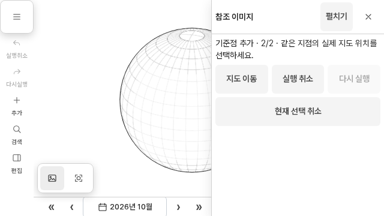
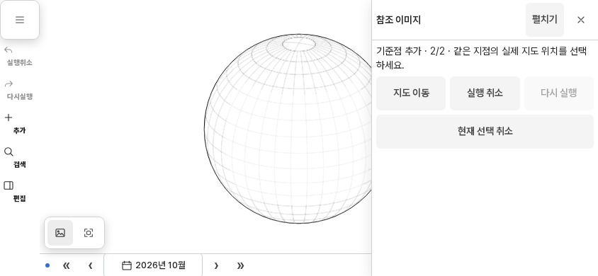

# 참고 이미지 UI — 최신 work/ui 통합 검증

> 보고서 ID: `DEV-REF-UI-SYNC-20261019` · 상태: `focused-verified / existing-base-check-failure / native-unverified` · 지도 반영: `not-applicable` · 색인일: 2026-10-19
>
> 조사 기준: 기존 feature HEAD `5e70dcf1fc130cb39b4b441b721ec9902048ace5`에 최신 `work/ui`의 `d99274160b97b8e47c884d44b3e49af3747ee04f`를 반영한 작업 트리
>
> 원격 통합 커밋: `9813535db9138bc00e55777049503cb79dd380bd`. 이후 원격 CI에서 확인한 이전 함수명 기반 검사 한 개를 입력 포트 동작 검사로 보완했다.
>
> 원본·출처: [Draft PR #134](https://github.com/kimjeon-il/Pando/pull/134), [실행 결과·입력 및 공유 자산 해시](reference-image-ui-integration-2026-10-19.evidence.json), [이전 P5 기록](reference-image-ui-p5-2026-10-18.md)

## 결과와 범위

최신 UI와 충돌하지 않도록 기존 `feature/reference-image-p1-layout-20261018`에 `work/ui`를 반영했다. 실제 텍스트 충돌을 해소하고, 새 편집기 문서 경로와 휴대폰 가로 레이아웃을 적용했다. 독립 검토에서 확인한 Space 지도 이동 안내 갱신 누락도 수정했다.

이번 추가 생산 수정은 `map-input-presentation.js`, `app-global-input-bindings.js`, `assets/css/layout/reference-images.css` 세 파일이다. 브라우저 spec 세 개를 canonical 편집기 진입으로 전환했고, 가로 화면 두 사례와 공통 편집 안내 한 사례를 추가했다. 기존 P1–P5의 보정 계산, 저장 형식과 원본 Blob, Undo/Redo 계약은 관련 조작 검사로 확인했다.

| 검증 | 결과 |
| --- | --- |
| 관련 단위 검사 | **고유 206개 통과**: 최초 통합 검증 64개와 CI 후속 참고 이미지 검사 161개의 합집합. 중복 19개를 제외 |
| CI 후속 참고 이미지 검사 | `tests/unit/reference-image-*.test.mjs` **20개 파일, 161/161 통과**, 실패·취소·skip 0개 |
| 실제 Chromium | **고유 38개 시나리오 통과**: 참고 이미지·workspace 21개, UX 16개, 공개 뷰어 1개 |
| 마지막 UI 추가분 반영 후 재검사 | **5개 통과**: desktop/mobile 자동 분석 취소 2개, 가로 화면 2개, 공개 뷰어 1개. 위 38개와 중복되므로 고유 수에 더하지 않음 |
| UI 계약 | `pnpm check:ui`의 7개 검사 그룹 통과 |
| 코드·변경분 | 변경 JavaScript·spec ESLint, 최신 UI 대비 `git diff --check`, 미해소 충돌 없음 확인 |
| 앱 small-project 준비 | **930개 파일, 56,115,506 bytes**의 크기와 SHA-256 확인. 참고 이미지 자산 28개와 인접 UI 자산 4개가 웹 원본과 바이트 동일 |
| 버전 경계 검사 | 최신 UI에도 동일하게 존재하는 viewer import-map 오류 **2개 남음**. 아래에 원인과 범위를 구분 |

검증은 Linux의 Node 24.19.0, pnpm 11.25.0, Playwright 1.62.1, Chromium 151.0.7922.34에서 실행했다. 저장소 CI는 Node 22 / pnpm 11.19.0이다. 단위 수는 파일별 직접 실행의 실제 case 요약으로 집계했으며, UI 계약 명령에 포함된 파일 단위 reporter 수를 추가 case로 세지 않았다.

## 충돌과 수정 근거

### 최신 입력 포트와 단계 안내의 공존

`map-input-presentation.js`의 텍스트 충돌은 최신 UI의 `productMode`와 주입된 `referenceInput` 포트를 유지해 해결했다. P4에서 추가한 `.reference-image-workflow-guide`를 대화형 표면 제외 선택자에 포함해 안내 카드를 누를 때 지도 드래그가 시작되지 않도록 했다. 최신 UI 대비 이 파일의 추가분은 해당 선택자 하나다. viewer/editor 분기와 최신 입력 소유자는 그대로 사용한다.

### canonical 편집기 문서로 진입

최신 UI의 `/`는 공개 viewer이며 실제 editor 문서는 `/apps/web-shell/editor.html`이다. `reference-image-ux`, `reference-image-auto-workflow`, `reference-image-auxiliary-surface` 세 spec이 기존 `tests/browser/helpers/editor-entry.mjs`의 `gotoEditor()`를 사용하도록 전환했다. 문서 존재 여부에 따른 fallback이나 별도 진입 alias를 만들지 않았다.

기존 overlay·line-refine·live-wire·workspace spec의 자동 병합 결과도 검토했다. 이들 역시 canonical helper를 유지하며, panel의 열림 상태가 반응형 전환 후 유지되는 기존 계약을 검사한다.

### 휴대폰 가로 화면의 버튼 접근과 접힘

최신 workspace는 `phone-landscape`를 모바일 편집 흐름으로 처리한다. 기존 참고 이미지 CSS의 `:not([data-layout="mobile"])`는 이 모드에 desktop 규칙을 적용했고, 짧은 시트의 목록·공통 제어·탭 행이 작업 영역을 압축했다. 수정 전 640×360에서 표시되고 활성화된 기준점 버튼의 실제 터치가 editor·tab·hint에 가로막히는 실패를 재현했다.

desktop 전용 선택자를 `wide`와 `compact`로 한정했다. 모바일과 가로 화면은 편집 본문 숨김·요약 줄바꿈·버튼 배치를 공유하고, 가로 화면에서 펼쳐진 본문은 하나의 스크롤 영역으로 처리한다. 편집 요약과 일반 접힘 상태는 이 본문 규칙에서 제외한다.

오른쪽 전체 높이 시트, `min(320px, 45vw)` 폭, 왼쪽 탐색 메뉴, 지도 여백은 최신 공통 UI의 기존 소유자가 결정한다. 참고 이미지 CSS 네 장은 bootstrap에서 별도로 로드하며 UI bundle 입력에 포함되지 않으므로 생성 bundle을 수정할 필요가 없다.

신규 640×360 및 844×390 검사는 실제 `hasTouch`/coarse pointer를 사용한다. 기준점 시작과 이미지 지점 선택, 지도 지점 단계 유지, 본문의 `hidden`/`inert`, 펼치기·다시 접기·취소·일반 접힘, 지도·탐색 메뉴·패널 영역을 확인한다. 취소 후 저장 레코드 전체와 원본 Blob의 바이트 및 지도 시점도 비교한다.

| 640×360: 지도 지점 입력 단계 | 844×390: 지도 지점 입력 단계 |
| --- | --- |
|  |  |

이 화면은 테스트의 작은 autosave fixture를 사용한다. 격자구의 모양 자체를 terrain 요청 실패나 성공의 근거로 해석하지 않는다.

### Space 지도 이동 시 공통 편집 안내 갱신

독립 검토에서 참고 이미지 패널이 열려 있으나 참고 이미지 입력은 비활성인 경우에도 앞쪽 Space 분기가 먼저 반환하는 것을 확인했다. 이 분기는 `spacePanActive`와 실제 지도 이동 상태를 바꾼 뒤 최신 `taskPresentation.syncEditingContext()` 호출을 건너뛰었다.

실제 `createGlobalInputBindings`와 `createTaskPresentation`을 연결한 검사에서, Space를 누른 뒤 `modeTaskInput.textContent`가 기존 편집 안내에 남는 RED를 확인했다. 조기 반환 전에 기존 안내 갱신 호출 한 줄을 추가했다. 이제 지도 이동 중에는 “지도 이동 중 · 놓으면 편집 계속”이 표시되고, keyup 후 원래 문구로 돌아온다. 검사에는 reference navigation, pan gate/host 진입·해제와 초안 불변도 포함한다. 수정 후 5/5 통과했고, 독립 재검토에서 해당 발견이 해결된 것을 확인했다.

### 원격 CI의 이전 함수명 검사 보완

통합 커밋 `9813535…`를 같은 Draft PR에 반영한 뒤 GitHub에서 최신 `work/ui`와 병합 가능한 상태를 확인했다. [Reference Image Integration 실행](https://github.com/kimjeon-il/Pando/actions/runs/39195646382)은 lint를 통과했지만, 단위 검사 161개 중 `reference-image-analysis-compat.test.mjs`의 소스 문자열 검사 한 개가 실패했다. 이로 인해 해당 실행의 browser matrix는 건너뛰었다.

기존 검사는 없어진 `referenceImageInputActive()` 호출의 문자열 위치를 찾았다. 최신 UI는 주입된 `referenceInput.isActive()` 포트를 사용한다. 해당 검사를 실제 `createMapInputPresentation()`이 controller에 전달하는 `interactiveTarget` 동작 검사로 바꿨다. 활성 참조 입력의 overlay·객체 hit 통과, controls·편집 필드·drawer·참고 이미지 패널·workflow-guide와 그 자손의 UI 소유권, 비활성 editor 및 `null` viewer 포트의 기존 차단 정책을 확인한다. 가운데 버튼·Space 지도 이동과 프로젝트 교체 중 입력 차단도 포함한다.

수정 전 해당 파일에서 **8 PASS / 1 FAIL**을 재현했고, 수정 후 **9 PASS / 0 FAIL** 및 ESLint 통과를 확인했다. CI와 같은 20개 참고 이미지 단위 파일을 직접 실행한 결과는 **161 PASS / 0 FAIL**이다. 최초 통합 검증 64개와 겹치는 interaction 6개·surface 8개·editing bridge 5개를 제외한 고유 단위 수는 **206개**다. 후속 변경은 검사 한 파일과 이 기록·evidence에 한정하며, 이미 검증한 제품 코드·브라우저 spec·공유 앱 자산의 해시는 변하지 않았다. 따라서 브라우저 38개나 앱 staging을 이 검사 수정 뒤 다시 실행한 것으로 집계하지 않는다. 후속 원격 CI 결과는 PR에 별도로 갱신한다.

## 최종 UI 추가분과 검증 시점

최초 통합 대상은 `5a07e8b276a4284114990eddee0d08ef6e85b80e`였다. 이 반영본에서 생산 수정 동결 후 참고 이미지·workspace 21개와 UX 16개가 통과했고, 공개 viewer 검사 1개도 통과했다.

마지막 확인 중 `work/ui`가 `44fb6d4…`와 `d992741…` 두 커밋만큼 전진했다. 추가 12개 파일은 공통 viewer resize 초기화 순서와 생성 자산·계약·관련 기록 변경이다. 해당 경로의 작업 트리와 index가 기존 base와 같음을 먼저 확인하고 최신 blob을 반영했다. 이번 참고 이미지 생산 수정과 추가 spec은 바뀌지 않았다.

`index.html`과 `apps/web-shell/editor.html`은 assetRevision 문자열을 정규화하면 이전 문서와 바이트 동일하다. 최종 추가분 반영 후 자동 분석 취소 2개, 가로 화면 2개, 공개 viewer 1개를 다시 실행해 모두 통과했다. 따라서 38개는 단계별 실행을 합친 고유 시나리오 수이며, 최종 SHA에서 38개를 다시 일괄 실행했다는 뜻은 아니다. 문서 비교 결과와 두 단계 입력 해시는 evidence에 기록했다.

앱 staging도 최종 추가분 반영 후 다시 실행했다. staging에 기록된 Git HEAD는 병합 전 feature 부모이므로 이 값을 검증 완료 커밋으로 해석하지 않는다. 실제 staging 파일 전체의 해시를 확인하고, 소스 입력과 공유 자산 32개의 해시를 별도로 기록했다.

## 환경 복원과 남은 한계

초기 실행에 필요한 현재 pinned 데이터 파일 누락을 복원했다. Playwright의 Chromium 다운로드가 ZIP 대신 오류 HTML을 반환해 동일 버전의 공식 Chrome for Testing archive를 사용했다. 별도로 확인한 외부 terrain manifest의 `ERR_CERT_AUTHORITY_INVALID`는 실제 Chromium 수신 체인과 일치하는 기존 플랫폼 CA 한 개를 NSS에 등록해 해결했다. 같은 URL이 HTTP 200으로 응답하고 인증서 검증 오류·실패 요청이 없어졌음을 확인했다. HTTPS 오류 무시 옵션이나 console 오류 필터를 추가하지 않았다. 환경 실패와 중간 RED는 PASS 수에 포함하지 않는다.

`node scripts/check-version.mjs`에는 다음 두 오류가 남는다.

- viewer import map의 `./assets/js/modules/app-accent.js`
- viewer import map의 `./assets/js/modules/app-map-settings.js`

검사 파일, viewer/editor 문서, viewer composition 입력은 최신 `d992741…`와 동일하다. 최신 UI가 공유하는 모듈 이름과 viewer import 경계 검사 규칙 사이의 기존 불일치로 구분한다. 이 때문에 전체 CI 성공을 주장하지 않는다. 기존 전역 GIS·영토·C++ 검사 전체를 이번 범위에서 재실행하거나 수정하지 않았다.

Windows·Android 네이티브 실기동, portable/native 패키징과 배포는 검증 범위 밖이다. 앱 결과는 small-project staging과 해당 단위 검사에 한정한다. 자동 분석 검사는 지연된 OCR 응답의 취소·격리와 저장 보호 범위이며 실제 OCR 정확도를 평가하지 않는다. Draft PR의 후속 CI 상태는 PR에서 별도로 확인한다.
